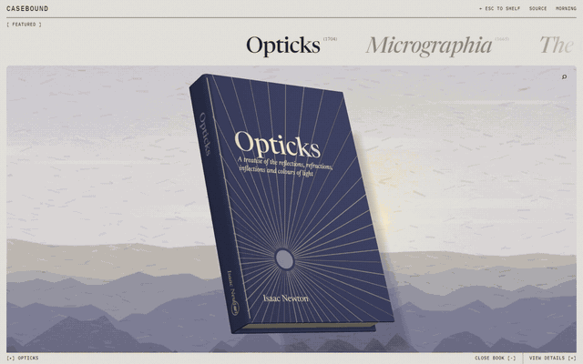
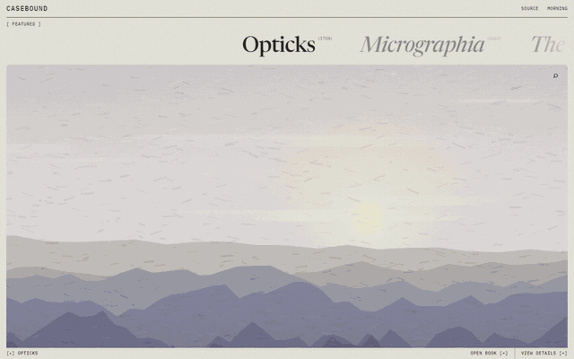
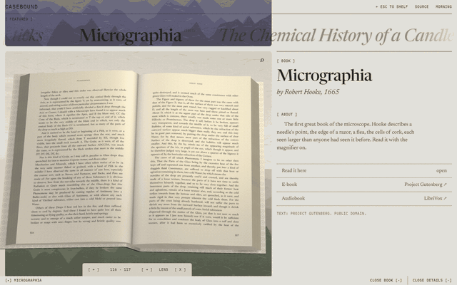
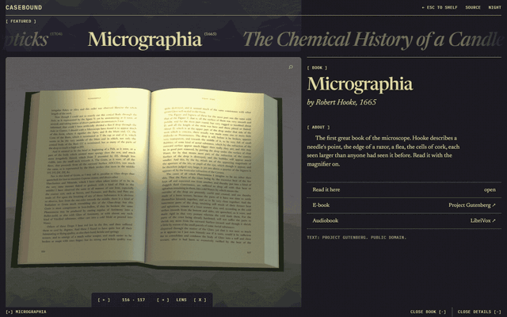

# Casebound

Casebound is a three.js toolkit and coding-agent skill for 3D books in the browser: lit hardcovers on a shelf you scroll, books that open, pages that turn like paper, a magnifier, and light effects that run over the print.



*Recorded from the demo: a book opens, three leaves turn, the book closes.*

[Live demo](https://othmanadi.github.io/casebound/) | [Install the skill](#install-the-skill) | [Add a book](#add-a-book) | [Extend it](#extend-it) | [How it was measured](#how-it-was-measured)

## What it is

Casebound draws hardcover books with three.js and WebGL and puts an ordinary web page around them. You scroll through a shelf, one book per screen. Each book holds at the centre for a moment, tilts toward the pointer and catches a spot of light that follows it. Press Space and the cover swings open, the pages part, and you can read. The pages are real text set on real leaves, and a leaf turns the way paper does: it lifts, bows against the air and lets the print on its far side show through.

It loads no model files and no pictures. The case, the hinges, the page blocks and the turning leaves are generated from a handful of dimensions. The cover, with its cloth weave, embossed title and foil, is painted in code from a few lines of JSON, and so are the page edges, the endpapers and the landscape behind each book. To add a book you add a folder with one small file.

Every number that shapes light or motion has a name, a range and a line of help in a registry, so a person or a coding agent can find it and change it while the page runs. An extension is a single file, and the repository ships a skill that teaches an agent how to use all of this.

Its light and motion values were measured. Light positions, damping times, the page turn and the opening sequence were taken from a public reference site frame by frame, and the rebuild is compared against it with the same tool. The results are in the table under [How it was measured](#how-it-was-measured).

## Try it

Open the [live demo](https://othmanadi.github.io/casebound/). It shows six public-domain books, from Newton's *Opticks* to Thoreau's *Walden*, each with a few dozen pages of its real text.

| Do this | To see |
| --- | --- |
| Scroll | Books ride up with the page, hold at the centre, and turn away as they leave |
| Move the pointer | The book tilts and a spot of light follows |
| `Space`, or **Open book** | The cover swings open, then the pages part |
| `→` and `←` | A leaf turns |
| `m`, or the lens button | A round magnifier follows the pointer |
| **View details**, then hover **E-book** or **Audiobook** | Scanlines, or rings, run over the whole book |
| The theme button | Morning, Noon and Night light |
| `Esc` | Back to the shelf |

To run it yourself:

```bash
git clone https://github.com/OthmanAdi/casebound.git
cd casebound
npm install --legacy-peer-deps
npm run dev
```

Then open `http://127.0.0.1:5183/`. It needs Node 22 or newer and a browser with WebGL 2.

## What you get

1. The shelf scrolls with weight. The page scrolls natively, each book rests for a short stretch of scrolling, then follows with a critically damped motion that never overshoots, and turns onto its side as it leaves.

   

   *Recorded from the demo: three books, one scroll each.*

2. Cloth, foil and paper take light differently. Covers are shaded as cloth, with a soft sheen at grazing angles, dark gaps between threads and a highlight that stays broad. Foil shifts its colour as the book turns. Four lights sit in presets that blend between Morning, Noon and Night, and the shadow of each book falls softly on a wall behind it.

3. A book opens in two stages. The front cover swings all the way round and shows the first page, then the pages part to where you were reading and the book turns to face you.

4. Leaves turn like paper. One function describes the cross-section of every sheet in the book, the stacked pages and the single leaf in the air alike, so a turning leaf starts and ends exactly on its stack. Its motion follows a simple physical rule in three phases: a push, a steady pace and a braked landing.

5. The magnifier is a second pass over the finished frame. It draws a round lens that enlarges the scene under the pointer and bends it toward the rim.

   

   *Recorded from the demo: the lens over a page of Hooke's Micrographia.*

6. Two light effects cover the whole book. Hover the e-book row and scanlines run down covers and pages, lines shear sideways and colours split. Hover the audiobook row and rings travel across the paper and ripple it.

   

   *Recorded from the demo: first the e-book row, then the audiobook row.*

7. At night the same shelf uses the dark preset, with a warm key light from the side.

   

   *Recorded from the demo with `?theme=dark`.*

## Install the skill

The repository carries an agent skill named `casebound`. It tells a coding agent how to add or restyle a book, change light and motion, write an extension, and check the result in a real browser.

| Agent | Install | Invoke |
| --- | --- | --- |
| Any agent, through the `skills` CLI | `npx skills add OthmanAdi/casebound --skill casebound` | `/casebound` in Claude Code, `$casebound` in Codex |
| Claude Code, as a plugin | `/plugin marketplace add OthmanAdi/casebound`, then `/plugin install casebound@casebound` | `/casebound:casebound` |
| Any agent, by copying | Copy [`.agents/skills/casebound`](.agents/skills/casebound) into the agent's skills folder (Claude Code: `~/.claude/skills/casebound`) | `/casebound` |

The skill holds instructions only. It works on a checkout of this repository, so clone it first or give the agent the path.

```text
/casebound Add "The Sceptical Chymist" by Robert Boyle with a dark brown buckram cover and gold foil, and fetch its text.
/casebound Make the Night theme's key light warmer and show me the shelf and one open spread.
/casebound Write an extension that puts a brass bookmark ribbon on the open book, with its length as a tunable number.
```

## Add a book

Make a folder with one record. The cover, the page edges and the pages follow from it.

```json
{
  "slug": "my-book",
  "title": "My Book",
  "author": "Me",
  "pages": 280,
  "background": "#5a6b7c",
  "cover": { "cloth": "#22324a", "ink": "#e8dcc0", "pattern": "rules", "foil": "#d9b25a", "grain": "buckram" }
}
```

Save it as `content/books/my-book/book.json` and add `"my-book"` to `featured` in [`content/library.json`](content/library.json). For text, put `{ "paragraphs": ["..."] }` in `text.json` beside it, or name a Project Gutenberg ebook in the record and run `node tools/content/gutenberg.mjs my-book`. Seven cover patterns, three binding materials and every field are listed in the [content reference](.agents/skills/casebound/references/content.md).

## Extend it

An extension is one file in [`extensions/`](extensions) that receives the engine and returns a function that undoes it. Three are included.

| Example | Adds | Try |
| --- | --- | --- |
| [`dust.ts`](extensions/dust.ts) | An object in the scene: dust motes in the light | add `?ext=dust` to the address |
| [`aged.ts`](extensions/aged.ts) | A look for every book surface: aged paper | `?ext=aged`, then press `a` |
| [`fan.ts`](extensions/fan.ts) | A shelf layout: books fan out like a hand of cards | `?layout=fan` |

```ts
import type { Extension } from '../src/engine';

const mine: Extension = (engine) =>
  engine.addObject({ id: 'prop.mine', label: 'My prop', object: myMesh });

export default mine;
```

Objects, surface effects, shelf layouts, light presets and page sources are covered in the [extension reference](.agents/skills/casebound/references/extending.md).

## Tune it

Open the console on the running page.

```js
casebound.engine.ctx.registry.describe('tag:light')          // what exists, with current values
casebound.engine.ctx.registry.set('light.rig', 'spotSwing', 50)  // try a value now
casebound.engine.ctx.registry.snapshot('reader')             // values ready to copy
```

The [tuning reference](.agents/skills/casebound/references/tuning.md) lists every registered id and the file each default lives in.

## The parts

| Part | What it does | Where |
| --- | --- | --- |
| Book | Generated case, hinges, page blocks and leaves | [`src/engine/book`](src/engine/book) |
| Painter | Covers, cloth and paper grain, page edges, endpapers and typeset pages, drawn in code | [`painter.ts`](src/engine/book/painter.ts) |
| Surface | Cloth shading, bump from grain and emboss, foil, the two light effects | [`surface.ts`](src/engine/book/surface.ts) |
| Stage | Light presets, the rig that blends them, the shadow wall | [`src/engine/stage`](src/engine/stage) |
| Shelf | Scroll to motion, leave and arrive poses, pointer tilt | [`src/engine/shelf`](src/engine/shelf) |
| Reader | Opening, page turn physics, pagination | [`src/engine/reader`](src/engine/reader) |
| Effects | Magnifier pass, hologram and radio | [`src/engine/effects`](src/engine/effects) |
| Core | Motion primitives, draw-on-demand loop, registry | [`src/engine/core`](src/engine/core) |
| Site | The page around the canvas | [`src/site`](src/site) |

The engine has one runtime dependency, three.js. The scene is drawn only when something changed, so an idle shelf costs a few frames per second.

## How it was measured

The reference was the Stripe Press website, a public site with a shelf of 3D books. It was studied in three ways: its shipped code was read for constants and techniques, its running scene was inspected in a browser, and its interactions were captured frame by frame under a virtual clock with [reanimate](https://github.com/NiazMorshed2007/reanimate), which records every shader value on every frame. The findings are in [`research/SPEC.md`](research/SPEC.md), about 110 numbered values, each with a note on how it was verified.

The rebuild is then captured with the same tool, the same settings and the same script, and the two are compared value by value. The log is [`research/PARITY.md`](research/PARITY.md).

| Compared | Result |
| --- | --- |
| Page turn forward, turn progress over 2.4 s | mean difference 0.0002 of a turn, worst 0.0008 |
| Page turn backward | mean 0.0065, ours starts one frame early |
| Pointer spot light position while the pointer moves | mean difference 0.3 to 0.6 % of its range |
| Key light direction while the pointer moves | mean difference under 0.001 |
| Hologram fade after the hover | same rate; start time corrected by 50 ms |
| Opening sequence | rebuilt in two stages after the first comparison showed one; to be measured again |

Parts that are not measured yet are listed in the log, and so are the mistakes made on the way.

No code, shader, model, artwork, text or typeface of the reference is in this repository, and the project is not affiliated with Stripe. [`PROVENANCE.md`](PROVENANCE.md) says what is here and where it came from. The capture tools are in [`tools/`](tools) and work on any page, including this one.

## Verify

| Command | Purpose |
| --- | --- |
| `npm run check` | Type check, unit tests and a production build |
| `node tools/capture/shot.mjs <url> <out.png>` | One picture of a page in a real browser, with console errors |
| `node tools/capture/record.mjs <url> <dir> <scene>` | A scripted visit as exact frames, for GIFs and review |
| `node tools/reanimate/capture-series.mjs --base <url> --out <dir>` | Frame-by-frame capture of the standard interactions |

The unit tests cover what cannot be judged by eye: motion at 30, 60 and 120 frames per second, the page turn against the measured curve, the scroll pipeline and the leaf geometry.

## What is missing

Dragging a page by hand, the curl of a page corner under the pointer, a row of spines for the books that are not featured, and spinning a book by dragging it. Touch layouts work but were not measured against the reference.

## Licence

Source under [Apache-2.0](LICENSE). The demo texts are in the public domain and come from Project Gutenberg. The typefaces are Newsreader and IBM Plex Mono, both under the SIL Open Font License. Libraries and notices are in [THIRD_PARTY_NOTICES.md](THIRD_PARTY_NOTICES.md).
