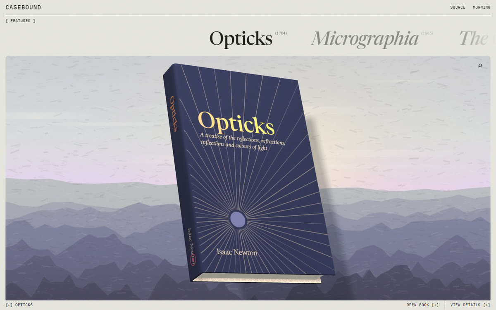
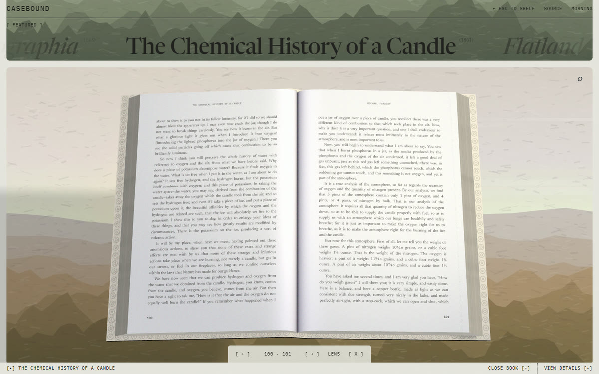
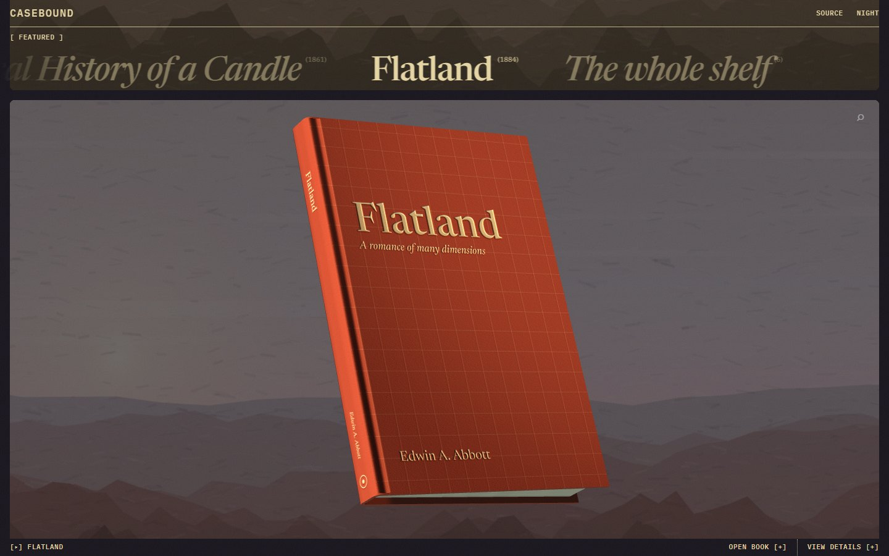
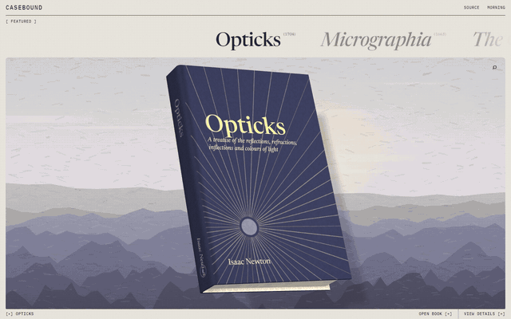
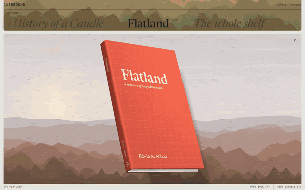
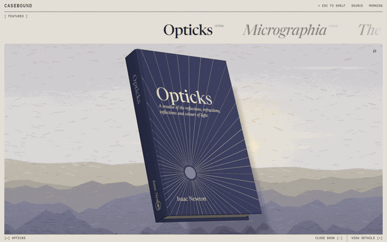
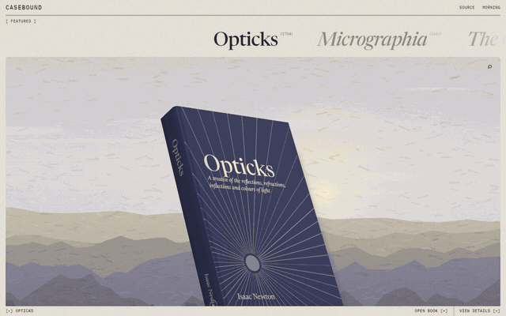
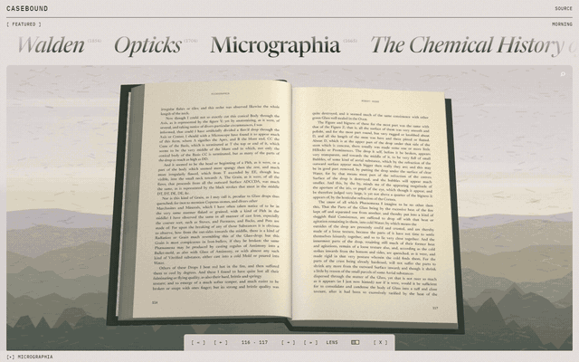

# Casebound

Casebound is a three.js toolkit and coding-agent skill for 3D books in the browser: lit hardcovers on a shelf you scroll, books you turn in your hand, a row of spines to choose from, books that open, pages you pull over like paper, a magnifier, and light effects that run over the print.


*Recorded from the demo: a book opens, three leaves turn, the book closes.*

[Live demo](https://othmanadi.github.io/casebound/) | [Install the skill](#install-the-skill) | [Add a book](#add-a-book) | [Extend it](#extend-it) | [How it was measured](#how-it-was-measured)

| On the shelf | Open | At night |
| --- | --- | --- |
|  |  |  |

## What it is

Casebound draws hardcover books with three.js and WebGL and puts an ordinary web page around them. You scroll through a shelf, one book per screen. Each book holds at the centre for a moment, tilts toward the pointer and catches a spot of light that follows it. Drag it and it turns in your hand and coasts on. Press Space and the cover swings open, the pages part, and you can read. The pages are real text, set line by line on real leaves, and a leaf turns the way paper does: you pull it over or let it fall back, it bows against the air, and the print on its far side shows through.

It loads no model files and no pictures. The case, the hinges, the page blocks and the turning leaves are generated from a handful of dimensions. The cover, with its cloth weave, embossed title and foil, is painted in code from a few lines of JSON, and so are the page edges, the endpapers and the landscape behind each book. To add a book you add a folder with one small file.

Every number that shapes light or motion has a name, a range and a line of help in a registry, so a person or a coding agent can find it and change it while the page runs. An extension is a single file, and the repository ships a skill that teaches an agent how to use all of this.

Its light and motion values were measured. Light positions, damping times, the page turn and the opening sequence were taken from a public reference site frame by frame, and the rebuild is compared against it with the same tool. The results are in the table under [How it was measured](#how-it-was-measured).

## Try it

Open the [live demo](https://othmanadi.github.io/casebound/). It shows six public-domain books, from Newton's *Opticks* to Thoreau's *Walden*, each with a few dozen pages of its real text.

| Do this | To see |
| --- | --- |
| Scroll, `↓` and `↑`, or a click on a title | Books ride up with the page, hold at the centre, and turn away as they leave. Left alone, the shelf shows its books one after another |
| Move the pointer | The book tilts and a spot of light follows. Over an open book its weight shifts to the page under the pointer |
| Drag the book | It turns in your hand, coasts on, and its trailing cover lifts |
| Scroll to the end | Every book of the library stands in a row, spine to the front. `←` and `→`, a press on a spine, or a pull on the row choose one, and it turns its cover forward |
| `Space`, or **Open book** | The cover swings open, then the pages before your place turn over in one wad |
| `→` and `←`, or a tap on a page | A leaf turns |
| Rest the pointer on a page | The corner under it lifts |
| Drag a page | The leaf follows your hand and its corner rolls over. Let go to turn it, or bring it back and it falls |
| `m`, or the lens button | A round magnifier follows the pointer |
| Press the book, or **View details**, then hover **E-book** or **Audiobook** | The print shears under scanlines and splits its colours, or rings ripple the pages |
| The theme button | Morning, Noon and Night light |
| `Esc` | One step back: out of the book, then out of the details |

To run it yourself:

```bash
git clone https://github.com/OthmanAdi/casebound.git
cd casebound
npm install --legacy-peer-deps
npm run dev
```

Then open `http://127.0.0.1:5183/`. It needs Node 22 or newer and a browser with WebGL 2.

## What you get

1. The shelf scrolls with weight. The page scrolls natively, each book rests for a short stretch of scrolling, then follows with a critically damped motion that never overshoots, and turns onto its side as it leaves.

   

   *Recorded from the demo: three books, one scroll each.*

2. A book turns in your hand. Drag the centred book and it follows through a spring, coasts when you let go, and the cover that trails the turn lifts off the pages for a moment.

   

   *Recorded from the demo: one drag, the coasting after it, and a second drag back.*

3. The whole library stands in a row. Past the last featured book every loaded book comes up from below, spine to the front. The chosen one turns its cover forward and steps out, and its neighbours make room. A row that fits the window stands centred; a longer one slides to the chosen book and keeps its ends inside the window. From there it opens like any other book.

   

   *Recorded from the demo: the row comes up, two steps to the right, a press on a spine.*

4. Cloth, foil and paper take light differently. Covers are shaded as cloth, with a soft sheen at grazing angles, dark gaps between threads, a tooth that stays visible across the room and a highlight that stays broad. Titles and ornaments are pressed into the cloth, so the light catches their walls, and each board meets the spine in a groove. Foil shifts its colour as the book turns. Paper has a fine film grain, and where two pages meet they catch each other's light while the fold lies in shade. Four lights sit in presets that blend between Morning, Noon and Night, and the shadow of each book falls softly on a wall behind it.

5. A book opens the way a book does. The front cover swings all the way round and shows the first leaf on the whole block. Then everything before your place turns over in one wad, the other stack lifts off its board, single leaves fan between the two and settle one after another. Open, the pages are not flat: they rise out of the gutter and come down to the fore-edge. The weight of the book follows the pointer, so the spine rolls under the pages while the boards stay where they lie.

6. Leaves turn like paper. One function describes the cross-section of every sheet in the book, the stacked pages and the single leaf in the air alike, so a turning leaf starts and ends exactly on its stack. Released, it follows a simple physical rule in three phases: a push, a steady pace and a braked landing. Held, it follows your hand: any pull that ends on the turning side turns the page, a pull you bring back lets it fall, and a leaf that is still in the air can be caught.

   

   *Recorded from the demo: a page pulled over, one let go half way, one pulled back.*

   A corner curls. The page under a resting pointer lifts its corner a little. A page in the hand rolls over where it is held and casts a soft shadow on itself, and a leaf in the air carries a curl that relaxes as it lands.

   

   *Recorded from the demo: a corner under the pointer, then the page taken by that corner.*

7. The pages are typeset. The text is flowed line by line in the book's typeface, justified, with running heads and folios, and a paragraph runs on over the page break, so every page is full.

8. The magnifier is a second pass over the finished frame. It draws a round lens that enlarges the scene under the pointer and bends it toward the rim.

   

   *Recorded from the demo: the lens over a page of Hooke's Micrographia.*

9. Two light effects cover the whole book. Hover the e-book row and scanlines run down covers and pages, lines shear sideways and colours split. Hover the audiobook row and rings travel across the paper and ripple it.

   

   *Recorded from the demo: first the e-book row, then the audiobook row.*

10. At night the light is dimmed. The picture falls back into dusk, the book is lit by a spot that follows the pointer, and the lens works in it like a reading glass under a lamp.

   

   *Recorded from the demo with `?theme=dark`.*

## Install the skill

The repository carries an agent skill named `casebound`. It tells a coding agent how to add or restyle a book, change light and motion, write an extension, and check the result in a real browser.

| Agent | Install | Invoke |
| --- | --- | --- |
| Any agent, through the `skills` CLI | `npx skills add OthmanAdi/casebound --skill casebound` | `/casebound` in Claude Code, `$casebound` in Codex |
| Claude Code, as a plugin | `/plugin marketplace add OthmanAdi/casebound`, then `/plugin install casebound@casebound` | `/casebound:casebound` |
| Any agent, by copying | Copy [`.agents/skills/casebound`](.agents/skills/casebound) into the agent's skills folder (Claude Code: `~/.claude/skills/casebound`) | `/casebound` |

The skill holds instructions only. It works on a checkout of this repository, so clone it first or give the agent the path.

```text
/casebound Add "The Sceptical Chymist" by Robert Boyle with a dark brown buckram cover and gold foil, and fetch its text.
/casebound Make the Night theme's key light warmer and show me the shelf and one open spread.
/casebound Write an extension that puts a brass bookmark ribbon on the open book, with its length as a tunable number.
```

## Add a book

Make a folder with one record. The cover, the page edges and the pages follow from it.

```json
{
  "slug": "my-book",
  "title": "My Book",
  "author": "Me",
  "pages": 280,
  "background": "#5a6b7c",
  "paper": "#e9e2cd",
  "cover": { "cloth": "#22324a", "ink": "#e8dcc0", "pattern": "rules", "foil": "#d9b25a", "grain": "buckram" }
}
```

Save it as `content/books/my-book/book.json` and add `"my-book"` to `featured` in [`content/library.json`](content/library.json). For text, put `{ "paragraphs": ["..."] }` in `text.json` beside it, or name a Project Gutenberg ebook in the record and run `node tools/content/gutenberg.mjs my-book`. Seven cover patterns, three binding materials and every field are listed in the [content reference](.agents/skills/casebound/references/content.md).

## Extend it

An extension is one file in [`extensions/`](extensions) that receives the engine and returns a function that undoes it. Three are included.

| Example | Adds | Try |
| --- | --- | --- |
| [`dust.ts`](extensions/dust.ts) | An object in the scene: dust motes in the light | add `?ext=dust` to the address |
| [`aged.ts`](extensions/aged.ts) | A look for every book surface: aged paper | `?ext=aged`, then press `a` |
| [`fan.ts`](extensions/fan.ts) | A shelf layout: books fan out like a hand of cards | `?layout=fan` |

```ts
import type { Extension } from '../src/engine';

const mine: Extension = (engine) =>
  engine.addObject({ id: 'prop.mine', label: 'My prop', object: myMesh });

export default mine;
```

Objects, surface effects, shelf layouts, light presets and page sources are covered in the [extension reference](.agents/skills/casebound/references/extending.md).

## Tune it

Open the console on the running page.

```js
casebound.engine.ctx.registry.describe('tag:light')          // what exists, with current values
casebound.engine.ctx.registry.set('light.rig', 'spotSwing', 50)  // try a value now
casebound.engine.ctx.registry.snapshot('reader')             // values ready to copy
```

The [tuning reference](.agents/skills/casebound/references/tuning.md) lists every registered id and the file each default lives in.

## Film it

A scripted visit is recorded as exact frames, one per step of the engine's clock, so the same build always gives the same film. `tools/capture/record.mjs` holds the scenes behind every recording on this page. A new animation is a scene in a file of your own, passed with `--scene-file` (see `tools/capture/scenes.example.mjs`). `tools/capture/gif.mjs` turns the frames into a GIF.

For a finished film with titles, and for a screen that catches flashing or frozen pictures before an effect ships, the skill's [film reference](.agents/skills/casebound/references/film.md) uses [raea](https://github.com/shinyobjectz/raea), a render engine for video compositions. The books are always drawn by the browser; raea composes and checks what was recorded.

## The parts

| Part | What it does | Where |
| --- | --- | --- |
| Book | Generated case, hinges, page blocks and leaves | [`src/engine/book`](src/engine/book) |
| Painter | Covers, cloth and paper grain, page edges, endpapers and typeset pages, drawn in code | [`painter.ts`](src/engine/book/painter.ts) |
| Surface | Cloth shading, bump from grain and emboss, foil, the two light effects | [`surface.ts`](src/engine/book/surface.ts) |
| Stage | Light presets, the rig that blends them, the shadow wall | [`src/engine/stage`](src/engine/stage) |
| Shelf | Scroll to motion, leave and arrive poses, pointer tilt, a book turned by hand, the row of spines | [`src/engine/shelf`](src/engine/shelf) |
| Reader | Opening, page turn physics, pagination | [`src/engine/reader`](src/engine/reader) |
| Effects | Magnifier pass, hologram and radio | [`src/engine/effects`](src/engine/effects) |
| Core | Motion primitives, draw-on-demand loop, registry | [`src/engine/core`](src/engine/core) |
| Site | The page around the canvas | [`src/site`](src/site) |

The engine has one runtime dependency, three.js. The scene is drawn only when something changed, so an idle shelf costs a few frames per second.

## How it was measured

The reference was the Stripe Press website, a public site with a shelf of 3D books. It was studied in three ways: its shipped code was read for constants and techniques, its running scene was inspected in a browser, and its interactions were captured frame by frame under a virtual clock with [reanimate](https://github.com/NiazMorshed2007/reanimate), which records every shader value on every frame. The findings are in [`research/SPEC.md`](research/SPEC.md), about 110 numbered values, each with a note on how it was verified.

The rebuild is then captured with the same tool, the same settings and the same script, and the two are compared value by value. The log is [`research/PARITY.md`](research/PARITY.md).

| Compared | Result |
| --- | --- |
| Every light at rest, on the shelf and in the reader: colours, directions, cone, shadow bias | equal to six digits |
| Page turn forward, turn progress over 2.4 s | mean difference 0.0002 of a turn, worst 0.0008 |
| Page turn backward | mean 0.0069, ours starts one frame early |
| Hologram and radio fades, per frame | equal to 0.0001 |
| Pointer tilt of a book on the shelf | equal to 0.03 degrees, no roll |
| Pointer spot light while the pointer moves | mean difference 0.3 % of its range |
| Height of the book on the shelf and in the reader | -3.0547 and -2.9817 against -3.0553 and -2.9819 |
| Wall shadow opacity, shelf and reader | 0.192 and 0.0534 against 0.193 and 0.0534 |
| Lens magnification at the centre | 1.440 against 1.442 |
| Opening, when half the turn is done | 1803 ms against 1835 ms (it was 1216 ms before the second pass) |
| Pages parting, page progress at seven times | within 0.03 |
| Brightest paper while the cover swings open | 228 of 255 against 228 |
| Reading place the open book answers to, pointer on three buttons | 0.688, 0.560, 0.352 from our rule against 0.694, 0.556, 0.360 |
| Shelf, a wheel notch: 10, 50, 90, 99 % of the book's move | 29, 93, 173, 265 ms against 29, 93, 173, 265 |
| Shelf, how far a book creeps in its dwell after 75 px of scroll | within 0.5 px of 11.8 px |
| Row of spines: cover turn of the arriving book | 20.8, 59.5, 79.5 degrees against 21.3, 57.8, 77.9 |
| Row of spines: slide after a step | 31, 171, 480, 888 ms against 32, 172, 481, 887 |
| Grain of a cloth spine, percent of brightness | 2.9 to 3.0 against 3.0 |
| Iridescent foil, saturation | 0.09 to 0.25 against 0.10 to 0.25 |

A second pass compared all ten interactions and found twelve differences, from a wall shadow that was up to 4.7 times too dark to an opening that ran 0.7 s early. A third pass measured the corrections. A fourth put frames side by side and found what the numbers had hidden: how the pages part, a first leaf that burnt out to white, a book that swung toward the pointer where the reference only shifts its weight, pages that lay flat, and seventeen differences in the row of spines. A fifth rebuilt the two page lights from the reference's own arithmetic and measured the covers: cloth grain, foil, the cloth turned in over the boards. A sixth captured the shelf under scrolling: wheel, dwell and the turn after a fast scroll. The table shows where things stand. The log lists each one with its numbers, what is still open, and the mistakes made on the way.

No model, artwork, text or typeface of the reference is in this repository, and none of its code was copied. A few behaviours do follow its formulas term by term, because matching them frame by frame left no other way: the two page lights, the way the pointer shifts the weight of an open book, the curve by which a book lingers while the page scrolls, and the ramp that spreads a wheel notch. Their terms and constants were read from the reference's shipped code and written again in this project's own functions and shaders. [`PROVENANCE.md`](PROVENANCE.md) says what is here and where it came from. The project is not affiliated with Stripe. The capture tools are in [`tools/`](tools) and work on any page, including this one.

## Verify

| Command | Purpose |
| --- | --- |
| `npm run check` | Type check, unit tests and a production build |
| `node tools/capture/check-reader.mjs <url>` | The reader in a real browser: keys, a page pulled over, one let go, taps, a leaf caught in the air |
| `node tools/capture/check-shelf.mjs <url>` | The shelf in a real browser: a book turned by hand, its coasting, a press that opens the details, the row of spines |
| `node tools/capture/shot.mjs <url> <out.png>` | One picture of a page in a real browser, with console errors |
| `node tools/capture/record.mjs <url> <dir> <scene>` | A scripted visit as exact frames, for GIFs and review |
| `node tools/capture/gif.mjs <dir> <out.gif>` | Those frames as a GIF |
| `node tools/reanimate/capture-series.mjs --base <url> --out <dir>` | Frame-by-frame capture of the standard interactions |

The unit tests cover what cannot be judged by eye: motion at 30, 60 and 120 frames per second, the page turn against the measured curve, the scroll pipeline, the leaf geometry and the coasting of a turned book. The two browser checks drive the engine's clock by hand, so they give the same result on a slow machine.

## What is missing

Touch works but was not measured against the reference. The demo texts are excerpts, so a thick book repeats its pages.

## Licence

Source under [Apache-2.0](LICENSE). The demo texts are in the public domain and come from Project Gutenberg. The typefaces are Newsreader and IBM Plex Mono, both under the SIL Open Font License. Libraries and notices are in [THIRD_PARTY_NOTICES.md](THIRD_PARTY_NOTICES.md).
